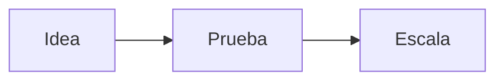

# Página personal y blog — Arnulfo Reyes

Sitio estático personal con blog en Markdown. Sin build tools ni frameworks: **HTML, CSS y JavaScript** servidos tal cual. La única excepción es `/garage164/`, que usa una Netlify Function pequeña para poder editarse en vivo — ver la [sección 9](#9-zona-privada-garage-164).

- Autor: Arnulfo Reyes
- Repositorio: <https://github.com/yosef7/personal-page-1>
- Licencia: [MIT](LICENSE)

---

## 1. Qué incluye

Cada página vive en su propia carpeta con un `index.html`, así las URLs quedan limpias (sin `.html`):

| Página | URL | Archivo | Qué hace |
| --- | --- | --- | --- |
| Inicio | `/` | `index.html` | Presentación, secciones de perfil y contacto |
| Sobre mí | `/about/` | `about/index.html` | Biografía y trayectoria |
| Mentoría | `/mentoria/` | `mentoria/index.html` | Programa de mentoría |
| Conferencias | `/conferencias/` | `conferencias/index.html` | Charlas y presentaciones |
| Blog | `/blog/` | `blog/index.html` | Listado de publicaciones (se genera desde `posts/posts.json`) |
| Artículo | `/blog/<slug>/` | `blog/<slug>/index.html` | Versión estática e indexable de cada post |
| Vista previa | `/blog/post.html?p=<slug>` | `blog/post.html` | Renderiza `posts/<slug>.md` en el navegador |
| Garage 164 | `/garage164/` | `garage164/` | Zona privada cifrada y editable en vivo, sin enlaces desde el sitio ([detalles](garage164/README.md)) |

Las URLs antiguas (`/about.html`, `/escalar-sin-romper.html`, etc.) redirigen con 301 a las nuevas desde `netlify.toml`.

Todos los enlaces internos usan rutas desde la raíz (`/css/styles.css`, `/blog/`), así una página funciona igual sin importar en qué carpeta esté.

El blog **no se compila**: `blog/post.html` es una sola plantilla que lee el slug de la URL, busca los metadatos en `posts/posts.json` y descarga el Markdown con `fetch`.

## 2. Stack

El sitio público se carga desde CDN, sin dependencias instaladas. El `package.json` solo existe para la Netlify Function de Garage 164 (`@netlify/blobs`) y para atajos de terminal:

- **Bootstrap 5.1.3** + tema *Start Bootstrap – Clean Blog* (base de `css/styles.css` y `js/scripts.js`)
- **marked** — Markdown → HTML
- **Mermaid 10** — diagramas dentro de los posts
- **highlight.js 11.9** — resaltado de sintaxis (tema `atom-one-dark`)
- **MathJax 3** — fórmulas matemáticas
- **Day.js** — formato de fechas en el listado del blog
- **Font Awesome 6.1** y **Google Fonts** (Lora + Open Sans)

## 3. Estructura

```
.
├── index.html                    # Inicio  → /
├── about/index.html              # Sobre mí → /about/
├── mentoria/index.html           # Mentoría → /mentoria/
├── conferencias/index.html       # Conferencias → /conferencias/
├── blog/
│   ├── index.html                # Listado → /blog/
│   ├── post.html                 # Plantilla dinámica (?p=<slug>)
│   └── <slug>/index.html         # Artículo estático → /blog/<slug>/
├── css/styles.css                # Estilos del sitio (incluye Bootstrap)
├── js/
│   ├── scripts.js                # Navbar y comportamiento del tema base
│   ├── blog.js                   # Construye el listado desde posts/posts.json
│   └── post.js                   # Carga el .md, Mermaid, highlight.js, MathJax y meta OG
├── posts/
│   ├── posts.json                # Índice de publicaciones (metadatos)
│   └── <slug>.md                 # Contenido de cada publicación
├── assets/
│   ├── img/                      # Imágenes de portada y de posts
│   └── *.ico                     # Favicons
├── garage164/                    # Zona privada cifrada, editable en vivo (ver su propio README)
├── netlify/functions/vault.mjs   # Lee/guarda el vault de Garage 164 en Netlify Blobs
├── scripts/check-site.py         # Validación del sitio (posts, sitemap, enlaces locales)
├── .github/
│   ├── workflows/check.yml       # CI: corre la validación en cada push y PR
│   └── dependabot.yml            # Actualizaciones mensuales de npm y Actions
├── .claude/skills/               # Skills del proyecto para Claude Code
├── robots.txt, sitemap.xml       # SEO
├── _headers                      # Cabeceras noindex/no-store para /garage164/*
├── netlify.toml                  # Netlify: Functions y redirecciones 301 de URLs antiguas
├── .editorconfig                 # Estilo común: UTF-8, LF, 2 espacios
├── .gitattributes                # LF en texto, binarios marcados
├── .gitignore                    # Secretos, datos privados, temporales y del sistema
└── .nvmrc                        # Versión de Node para la Function
```

## 4. Requisitos

- **Python 3** (para el servidor local) — viene preinstalado en macOS.
- **Node.js 20+** (ver `.nvmrc`) — solo si vas a publicar la colección de `garage164/` desde la terminal.
- Un navegador moderno y conexión a internet (las librerías vienen de CDN).

No hay `npm install` para el sitio público. No hay paso de compilación.

## 5. Levantar el sitio en local

```zsh
git clone https://github.com/yosef7/personal-page-1.git
cd personal-page-1
python3 -m http.server 8001   # o: npm run serve
```

Abre <http://127.0.0.1:8001/>.

> **Importante:** no valides el blog abriendo los `.html` con doble clic (`file://`). `blog.js` y `post.js` usan `fetch`, que el navegador bloquea en el protocolo de archivos. Siempre por HTTP.
>
> **Garage 164 es la excepción:** su lectura y escritura dependen de la Netlify Function (`/garage164/api/vault`), que `python3 -m http.server` no puede servir. En local, la pantalla de acceso carga pero no hay forma de abrir la colección; para probar cambios de `index.html`/`app.js`/`styles.css` de esa sección, hazlo contra el sitio ya desplegado.

URLs útiles mientras trabajas:

| Qué revisar | URL |
| --- | --- |
| Inicio | `http://127.0.0.1:8001/` |
| Blog | `http://127.0.0.1:8001/blog/` |
| Un artículo | `http://127.0.0.1:8001/blog/escalar-sin-romper/` |
| Vista previa de un `.md` | `http://127.0.0.1:8001/blog/post.html?p=escalar-sin-romper` |
| Garage 164 | `http://127.0.0.1:8001/garage164/` |

Para detener el servidor: `Ctrl+C`. Si el puerto está ocupado, usa otro (`python3 -m http.server 8002`).

## 6. Publicar una nueva entrada del blog

### Paso 1 — Escribe el Markdown

Crea `posts/<slug>.md`. El slug debe ser **corto, en minúsculas y con guiones** (`escalar-sin-romper`, no `como-escalar-sistemas-sin-romperlos-en-produccion`).

Todo post debe cerrar con:

```markdown
Gracias por leer mi publicación. Recibo con mucho agrado los comentarios y las críticas constructivas.
Me pueden encontrar en IG @arnulfo.
```

### Paso 2 — Consigue una imagen relevante

Busca una imagen sin marca de agua y de uso libre (Unsplash, Pexels, Pixabay) que **corresponda al tema del post**, no un genérico. Guárdala en `assets/img/` con un nombre claro, idealmente igual al slug: `assets/img/<slug>.jpg`.

### Paso 3 — Regístralo en `posts/posts.json`

Agrega el objeto al **inicio** del arreglo:

```json
{
  "slug": "mi-nuevo-articulo",
  "title": "Mi nuevo artículo",
  "subtitle": "Una descripción concreta y útil",
  "date": "2026-08-23",
  "author": "Arnulfo Reyes",
  "image": "assets/img/mi-nuevo-articulo.jpg"
}
```

| Campo | Obligatorio | Notas |
| --- | --- | --- |
| `slug` | Sí | Debe coincidir exacto con `posts/<slug>.md` |
| `title` | Sí | Directo, que comunique el valor práctico |
| `subtitle` | No | Concreto, sin frases infladas |
| `date` | Sí | Formato `YYYY-MM-DD`; ordena el listado de forma descendente |
| `author` | No | Por defecto “Arnulfo Reyes” |
| `image` | Sí | Ruta relativa; se usa como fondo del encabezado y como `og:image` |

### Paso 4 — Verifica

```zsh
python3 scripts/check-site.py   # o: npm run check
curl -s -o /dev/null -w "%{http_code}\n" "http://127.0.0.1:8001/blog/post.html?p=mi-nuevo-articulo"
```

Y abre la página en el navegador: el título, la fecha, la imagen del encabezado y el contenido deben verse bien en móvil y escritorio.

### Renombrar un post

Cambia **las dos cosas**: el archivo `posts/<slug>.md` y el campo `slug` en `posts/posts.json`. Si no coinciden, la página muestra “No se pudo cargar el artículo”.

## 7. Qué puedes usar dentro de un post

Además del Markdown estándar, `js/post.js` procesa:

**Diagramas Mermaid** — bloque con lenguaje `mermaid`:

~~~markdown

~~~

Se convierte en un `<figure class="post-diagram">` responsivo. Por defecto usa el tema `base` con la paleta del sitio; puedes pedir otro (`base`, `default`, `neutral`, `forest`, `dark`) declarándolo dentro del bloque, por ejemplo `%% theme: forest %%`.

**Código con resaltado** — declara el lenguaje para mejor resultado:

~~~markdown
```python
def hola():
    return "mundo"
```
~~~

**Matemáticas** — sintaxis TeX compuesta por MathJax: en línea `\( x^2 \)`, en bloque `$$ ... $$` o `\[ ... \]`. El signo `$` simple **no** activa el modo matemático.

**Tablas** — se envuelven automáticamente para permitir scroll horizontal en móvil sin romper la columna del artículo.

## 8. Convenciones al editar

- Mantén la estructura estática: HTML, CSS y JS planos. **No agregues build tools** salvo que se pida explícitamente.
- No toques páginas, estilos ni scripts ajenos al cambio solicitado.
- Cualquier elemento visual ancho (diagramas, tablas, imágenes) debe ser responsivo.
- El idioma por defecto del sitio y de los posts es español.
- Los posts se escriben para escanearse: secciones claras, ejemplos concretos, conclusiones accionables.
- Antes de dar por terminado un cambio, corre `python3 scripts/check-site.py` y verifica que las páginas afectadas respondan `200 OK` sobre HTTP.
- Si agregas una página pública, súmala a `sitemap.xml`.

## 9. Zona privada: Garage 164

`garage164/` es una sección protegida por contraseña y editable en vivo: los datos se guardan cifrados con AES-256-GCM y se descifran en el navegador; una Netlify Function (`netlify/functions/vault.mjs`) los guarda en Netlify Blobs en vez de en un archivo estático, así que agregar o editar un carrito desde la página queda visible al instante, sin `git push`. La Function nunca conoce la contraseña ni puede descifrar nada — solo verifica una credencial derivada de ella antes de aceptar una escritura. `robots.txt` y `_headers` excluyen la ruta de los buscadores, pero **no hay control de acceso a nivel de página**: la URL es alcanzable, lo que protege es el cifrado.

El archivo en claro `garage164/data.json` está en `.gitignore` y nunca debe publicarse. El procedimiento completo de configuración, publicación y el detalle de la Function están en [garage164/README.md](garage164/README.md).

## 10. Despliegue

El sitio está alojado en **Netlify**, en <https://www.arnulforeyes.com/>, y se publica desde este repositorio. Cada `git push` a `main` dispara un despliegue nuevo.

Como no hay compilación, el despliegue consiste en copiar la raíz del repositorio: tarda menos de un minuto.

- `_headers` aplica cabeceras `noindex` y `no-store` a `/garage164/*`. Es el formato nativo de Netlify, así que funciona sin configuración adicional.
- `netlify/functions/vault.mjs` se detecta y despliega automáticamente por estar en `netlify/functions/` — no requiere `netlify.toml` ni build.
- Esa función depende de la variable de entorno `GARAGE164_WRITE_HASH` (Site settings → Environment variables). Sin ella, la lectura de Garage 164 funciona pero cualquier intento de guardar falla con 403. Ver [garage164/README.md](garage164/README.md#4-configuración-inicial-paso-a-paso).
- No se requiere paso de build ni comando de instalación para el resto del sitio.
- GitHub Actions (`.github/workflows/check.yml`) valida cada push y PR: posts, sitemap, enlaces locales, sintaxis de los JS y que `garage164/data.json` no esté versionado. Si falla, revisa antes de que Netlify publique.

## 11. Problemas frecuentes

| Síntoma | Causa | Solución |
| --- | --- | --- |
| El blog aparece vacío o dice “No se pudo cargar el listado” | Abriste el HTML con `file://` o `posts.json` tiene un error de sintaxis | Sirve por HTTP y valida el JSON |
| “No se pudo cargar el artículo” | El `slug` de `posts.json` no coincide con el nombre del `.md` | Iguala ambos nombres |
| El encabezado del post sale sin imagen | La ruta de `image` es incorrecta o el archivo no está en `assets/img/` | Corrige la ruta relativa |
| El diagrama se ve como bloque de código | Error de sintaxis en Mermaid | Revisa el bloque; `post.js` deja el código original cuando el render falla |
| Los estilos o iconos no cargan | Sin conexión a internet | Las librerías vienen de CDN; se requiere red |
